


# GhostVPN v4.9.26-BETA · Windows 10/11

## Sikker. Krypteret. Usynlig.

### Skift din IP med ét klik: OpenVPN, WireGuard, Shadowsocks og proxy i ét mørkt, hurtigt program til Windows.

**Windows 10 og 11 · 64-bit · én .zip-fil, ingen installation**

## [🇵🇱 Polski](../README_PL.md) &nbsp; [🇬🇧 English](../README.md) &nbsp; [🇩🇪 Deutsch](README_DE.md) &nbsp; [🇨🇿 Čeština](README_CS.md) &nbsp; [🇸🇰 Slovenčina](README_SK.md) &nbsp; [🇺🇦 Українська](README_UK.md) &nbsp; [🇷🇺 Русский](README_RU.md) &nbsp; [🇱🇹 Lietuvių](README_LT.md) &nbsp; [🇱🇻 Latviešu](README_LV.md) &nbsp; [🇪🇪 Eesti](README_ET.md) &nbsp; [🇪🇸 Español](README_ES.md) &nbsp; [🇫🇷 Français](README_FR.md) &nbsp; [🇮🇹 Italiano](README_IT.md) &nbsp; [🇵🇹 Português](README_PT.md) &nbsp; [🇳🇱 Nederlands](README_NL.md) &nbsp; [🇸🇪 Svenska](README_SV.md) &nbsp; [🇩🇰 Dansk](README_DA.md) &nbsp; [🇳🇴 Norsk](README_NO.md) &nbsp; [🇫🇮 Suomi](README_FI.md) &nbsp; [🇭🇺 Magyar](README_HU.md) &nbsp; [🇷🇴 Română](README_RO.md) &nbsp; [🇧🇬 Български](README_BG.md) &nbsp; [🇬🇷 Ελληνικά](README_EL.md) &nbsp; [🇭🇷 Hrvatski](README_HR.md) &nbsp; [🇷🇸 Српски](README_SR.md) &nbsp; [🇸🇮 Slovenščina](README_SL.md) &nbsp; [🇹🇷 Türkçe](README_TR.md) &nbsp; [🇻🇳 Tiếng Việt](README_VI.md) &nbsp; [🇮🇩 Indonesia](README_ID.md)

[Vejledning (EN)](../docs/USER_GUIDE.md) · [FAQ](../docs/FAQ.md) · [Licens](../LICENSE)

---

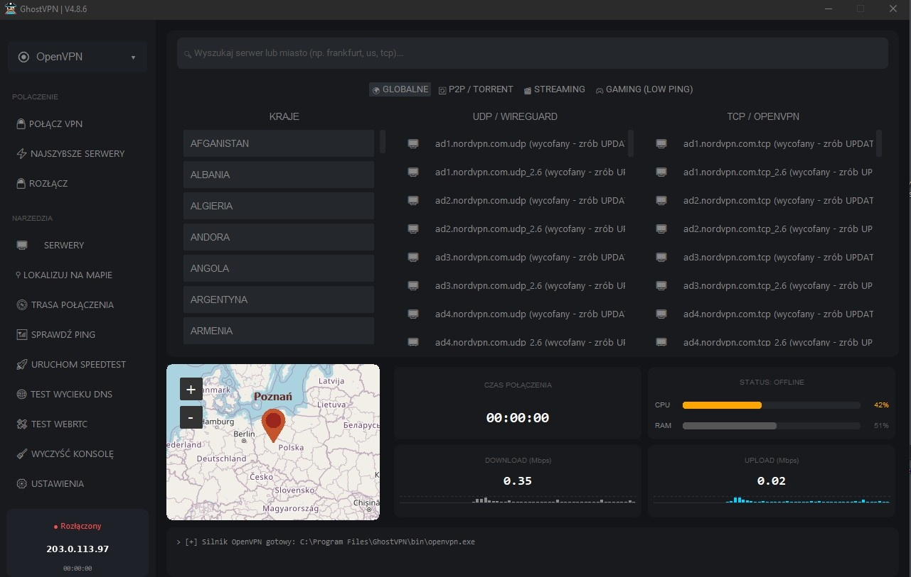

## 👻 Hvad er GhostVPN?

### GhostVPN skjuler din rigtige IP-adresse.

Det forbinder dig til en VPN-server eller proxy efter eget valg, og hjemmesider ser serverens IP i stedet for din.

Du beholder din egen VPN-konto (`NordVPN`, `Surfshark`, `ProtonVPN`, `Mullvad` og mange flere) eller bruger gratis servere. GhostVPN erstatter alle deres separate apps med **ét vindue**: vælg et land, klik på **CONNECT VPN**, færdig.

## 🚀 Hurtig start

**1.** **Hent** `GhostVPN_portable.zip` fra [Releases](https://github.com/MRGREGOR85/GhostVPN-BETA/releases/latest) og pak den ud, fx til `C:\GhostVPN`.  
**2.** **Kør** `URUCHOM_GHOST.bat` og klik på **Ja**, når Windows beder om administratorrettigheder.  
**3.** **Vælg en udbyder** øverst til venstre og tilføj servere: **SETTINGS → ADVANCED → UPDATE** eller **SETTINGS → BROWSE CONFIG** til dine egne `.ovpn`-filer.  
**4.** **Gem dit VPN-login**: **SETTINGS → VPN ACCOUNT**.  
**5.** **Vælg land og server**, klik på **CONNECT VPN**. Kortet viser din nye placering.  

**Du skal bruge:** Windows 10/11 · [Python 3.10+](https://www.python.org/downloads/) (sæt flueben ved *Add Python to PATH*) · [OpenVPN](https://openvpn.net/community-downloads/) · administratorrettigheder. Manglende Python-biblioteker installerer sig selv ved første start.

👉 Trin for trin: **[Vejledning (EN)](../docs/USER_GUIDE.md)** · Problemer: **[FAQ](../docs/FAQ.md)**

## ✨ Funktioner

| | Funktion | Hvad den gør |
|:-:|---|---|
| 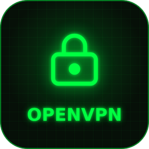 | **OpenVPN** | Forbinder med `.ovpn`-profiler fra 19 VPN-udbydere, uden deres apps. UDP eller TCP, automatisk skift UDP → TCP. |
| 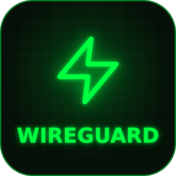 | **WireGuard** | Hurtig moderne tunnel fra din `.conf`-fil. Programmet tjekker handshake, så du ved, at tunnelen virkelig virker. |
| 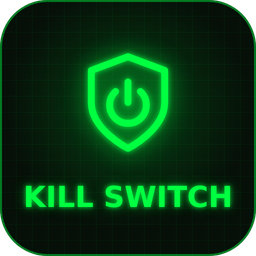 | **Kill Switch** | Bruger Windows Firewall til at blokere al trafik uden for VPN. Hvis tunnelen falder ud, lækker din rigtige IP aldrig. |
| 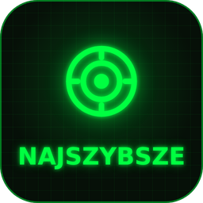 | **Hurtigste servere** | Live ping for hver server og Smart Connect til den hurtigste med ét klik. Faner til P2P, streaming og gaming. |
| 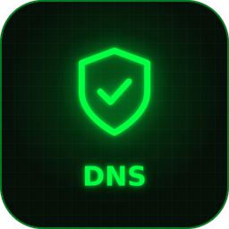 | **Sikker DNS** | Indstiller Cloudflare, Quad9, AdGuard eller OpenDNS til IPv4 og IPv6 og rydder DNS-cachen. |
| 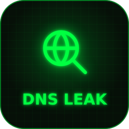 | **Lækagetests** | DNS-lækagetest og WebRTC-test: tjek, at intet afslører din rigtige IP. |
| 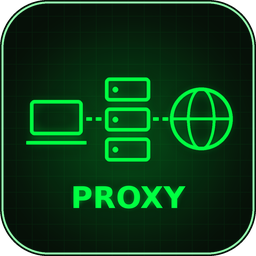 | **Proxy** | SOCKS5- og HTTP-proxy med login, en lokal bro og Firefox startet gennem proxyen. 19 premium-proxyudbydere. |
| 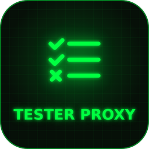 | **Proxytester** | Flertrådet tester til proxylister (`.txt`) med liveresultater: levende eller død. |
| 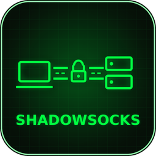 | **Shadowsocks** | Krypteret tunnel, der er svær at blokere, med understøttelse af `ss://`-links og en vejledning til din egen server. |
| 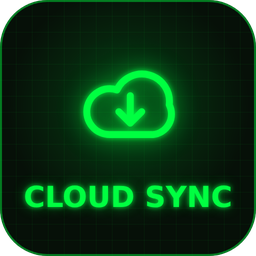 | **Cloud Sync** | Henter opdaterede serverlister fra NordVPN, PrivadoVPN, PIA, Mullvad, AirVPN og andre med ét klik. |
| 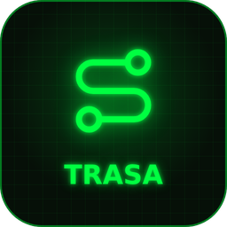 | **Rutekort** | Viser på kortet, hvilke lande og knudepunkter din trafik går igennem. |
| 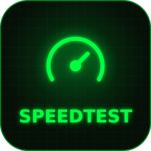 | **Speedtest og datatæller** | Live grafer for download og upload, speedtest og hvor meget data sessionen brugte. |
| 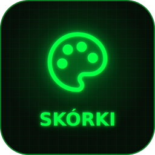 | **Temaer og meddelelsesområde** | 20 farvetemaer, polsk og engelsk, kører fra meddelelsesområdet ved uret. |
| 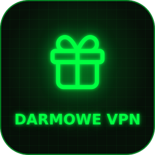 | **Gratis VPN** | Færdige poster til de offentlige servere fra VPN Gate og IPSpeed. |

## 🌍 Understøttede udbydere

### GhostVPN sælger ikke VPN: du bruger din egen konto eller de gratis servere.

| 💳 Betalt VPN | 🆓 Gratis VPN | 🔧 Egen WireGuard | 💼 Betalt proxy |
|:-:|:-:|:-:|:-:|
| **19 udbydere** | `VPN Gate` · `IPSpeed` | **din `.conf`-fil** | **19 udbydere** |

### 🆓 Gratis VPN (OpenVPN): ingen konto, ingen betaling

| Udbyder | Hvordan serverne kommer ind i GhostVPN |
|---|---|
| `VPN Gate` | ⚡ automatisk, ét klik: gratis offentlige servere |
| `IPSpeed` | ⚡ automatisk, ét klik: gratis offentlige servere |

Hvor: **SETTINGS → ADVANCED → 🆓 DARMOWE VPN (free VPN) → UPDATE**. Hver hentet profil tjekkes, før den gemmes.

> ⚠️ Gratis offentlige servere er langsommere og drives af fremmede. Brug en betalt VPN til netbank og vigtige logins.

<b>💳 Betalt VPN: alle 19 udbydere (klik for at vise)</b>

| Udbyder | Hvordan serverne kommer ind i GhostVPN |
|---|---|
| `NordVPN` (vises som **OpenVPN** på listen) | ⚡ automatisk, ét klik (5000+) |
| `PrivadoVPN` | ⚡ automatisk, ét klik |
| `PIA VPN` | ⚡ automatisk, ét klik |
| `IPVanish` | ⚡ automatisk, ét klik |
| `PureVPN` | ⚡ automatisk, ét klik |
| `VyprVPN` | ⚡ automatisk, ét klik |
| `IVPN` | ⚡ automatisk, ét klik |
| `FastVPN (Namecheap)` | ⚡ automatisk, ét klik |
| `OVPN.com` | ⚡ automatisk, ét klik |
| `Mullvad VPN` | 🔑 automatisk med dit kontonummer (OpenVPN + WireGuard) |
| `AirVPN` | 🔑 automatisk med dit Direct Link |
| `CyberGhost` | 📁 filer fra udbyderens hjemmeside (knapperne WEBSITE + FOLDER) |
| `PrivateVPN` | 📁 filer fra udbyderens hjemmeside (knapperne WEBSITE + FOLDER) |
| `Perfect Privacy` | 📁 filer fra udbyderens hjemmeside (knapperne WEBSITE + FOLDER) |
| `HMA VPN` | 📁 filer fra udbyderens hjemmeside (knapperne WEBSITE + FOLDER) |
| `TorGuard` | 📁 filer fra udbyderens hjemmeside (knapperne WEBSITE + FOLDER) |
| `ProtonVPN` | 📁 `.ovpn`-filer fra udbyderens hjemmeside |
| `ExpressVPN` | 📁 `.ovpn`-filer fra udbyderens hjemmeside |
| `Surfshark` | 📁 `.ovpn`-filer fra udbyderens hjemmeside |

<b>🔧 WireGuard: din egen fil (klik for at vise)</b>

WireGuard er ikke en udbyder, men en hurtig VPN-protokol. Hvis din udbyder (betalt eller gratis abonnement) giver dig en WireGuard `.conf`-fil, så læg den i GhostVPN: vælg **WireGuard** på listen → **SETTINGS → BROWSE CONFIG**. Mullvad-brugere får WireGuard-filer automatisk.

<b>💼 Betalt proxy og gratis proxylister (klik for at vise)</b>

**Betalt proxy:** `Proxy Store` · `Bright Data` · `Oxylabs` · `Decodo` · `NetNut` · `SOAX` · `IPRoyal` · `Rayobyte` · `Infatica` · `ProxyEmpire` · `ProxyRack` · `Shifter` · `NodeMaven` · `Webshare` · `DataImpulse` · `Proxy-Seller` · `Geonix` · `Proxy6` · `Proxy-Cheap`

Du gemmer udbyderens proxyliste som en `.txt`-fil og indlæser den i GhostVPN (login og adgangskode understøttes).

**Gratis proxylister** (`IP:port`, hent som `.txt` og tjek i den indbyggede proxytester): `Advanced.name` · `Spys.one` · `FreeProxy.world` · `Free-Proxy.cz` · `Geonix` · `FloppyData` · `Proxy5.net` · `RoundProxies` · `ProxyScrape` · `Free-Proxy-List.net` · `IPRoyal (free)` · `NodeMaven`

<b>🖥️ Din egen server: Squid og Shadowsocks (klik for at vise)</b>

| Server | Hvad det er |
|---|---|
| `Squid` | din egen HTTP-proxy på en VPS, kun til dig |
| `Shadowsocks` | din egen krypterede tunnel på en VPS, svær at blokere |

GhostVPN opretter filen `SERWER Squid + Shadowsocks.txt` med kommandoer, du kan kopiere for at sætte dem op.

## 🔐 OpenVPN, WireGuard eller proxy?

| | OpenVPN | WireGuard | Proxy |
|---|---|---|---|
| Kryptering | ✔ AES-256 | ✔ ChaCha20 | ✘ kun sidens HTTPS |
| Beskytter hele systemet | ✔ ja | ✔ ja | kun valgte apps |
| Hastighed | god | meget høj | afhænger af serveren |
| Forbindelse | et par sekunder | et øjeblik | straks |
| Kill Switch | ✔ | ✔ | — |
| Bedst til | dagligt brug, blokerede netværk | spil, streaming | hurtigt IP-skift i browseren |

Dit VPN-login krypteres af Windows (DPAPI) og bliver på din computer. GhostVPN har ingen konto, ingen reklamer og ingen sporing.

## 📜 Licens

### GhostVPN tilhører udelukkende sin forfatter, MRGREGOR85. Kun til privat brug derhjemme.

Du må hente det fra denne side og bruge det på din egen computer. Du må **ikke** dele det med andre, uploade det andre steder, sælge det, bruge det kommercielt eller ændre det. Alle henter deres egen kopi fra denne officielle side.

Fuld tekst: [LICENSE](../LICENSE). Du kan også læse den i programmet: **SETTINGS → 📜 LICENSE**.

GhostVPN er et uafhængigt program og har ingen tilknytning til nogen VPN- eller proxyudbyder. Kortdata © [OpenStreetMap](https://www.openstreetmap.org/copyright).

## 🎬 YouTube

<a href="https://youtu.be/Z6WQEQ91pls">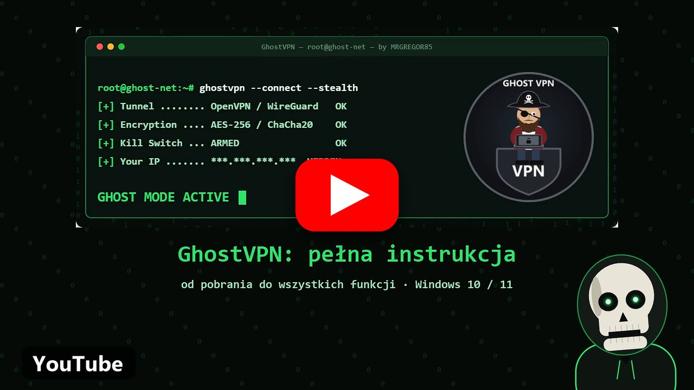</a>

## 👨‍💻 Forfatter

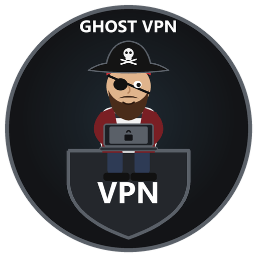

### MRGREGOR85

[github.com/MRGREGOR85](https://github.com/MRGREGOR85)

Piraten bag GhostVPN. Jeg laver programmer til folk, der vil forblive usynlige på internettet.

### Hvis GhostVPN hjælper dig, så giv det en ⭐

